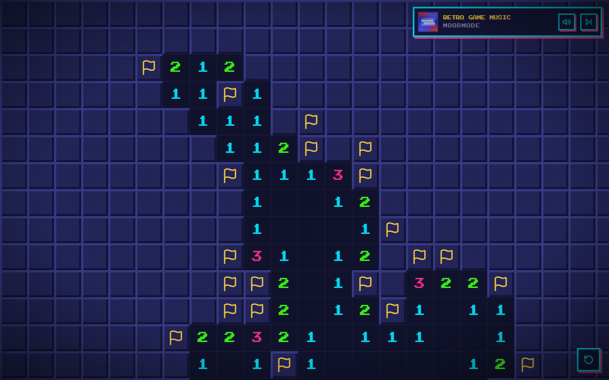

# Harmonie's Infinite Minesweeper

Harmonie's infinite minesweeper, an infinite version of minesweeper where caos, high scores &amp; progression are the goal.

<p align="center">
    
</p>

# How to run

Run a quick build with:

```bash copy
npm install
npm run dev
```

Or a preview of the production build run the following:

```bash copy
npm install
npm run build
npm run preview
```

Both methods display the game but at different addresses:

- Dev: http://localhost:5173/
- Preview: http://localhost:4173/

For production serve the `dist/` folder
